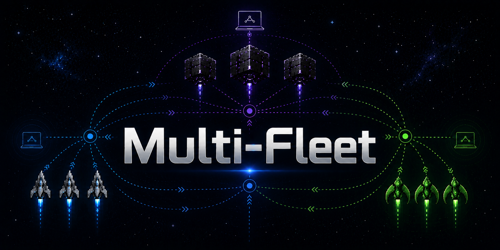

<div align="center">



# Multi-Fleet

**Cross-machine AI collaboration for Claude Code, Cursor, VS Code, Codex, and Gemini.**

Real-time peer-to-peer messaging with a **9-priority self-healing fallback chain**, session-aware autonomous task agents, HMAC-signed communication, and fleet-wide productivity visibility. **Messages always deliver** — even when NATS is down, HTTP is blocked, and SSH is your only path.

[](LICENSE)
[](https://www.python.org/downloads/)
[](https://nats.io/)
[](https://claude.com/claude-code)
[](#zero-silent-failures)
[](CONTRIBUTING.md)

[**Quick Start**](#quick-start) · [**Architecture**](ARCHITECTURE.md) · [**Demo**](DEMO.md) · [**Install**](INSTALL.md) · [**Docs**](docs/index.md)

</div>

---

## Why Multi-Fleet?

You have three Macs. Two of them are working on your codebase right now. The third is sleeping. One has the database. One has the GPU. One has your IDE open.

**Without Multi-Fleet:** You manually `ssh` into each machine, copy-paste commands, lose context, forget which session knows what. When one machine drops off Wi-Fi, your workflow stops.

**With Multi-Fleet:** Your AI assistant on mac1 sends a task to mac2, mac2 picks it up in its own Claude Code session, mac3 wakes from sleep to run the GPU job. If NATS goes down mid-conversation, the message reroutes through HTTP. If HTTP fails, it falls through SSH. **The message gets there.**

```
   "@mac3 train the model overnight"
            │
            ▼
   ┌──────────────────────────────────────────────────┐
   │  mac1 (you)  ◀── 9-priority cascade ──▶  mac3   │
   │                                                  │
   │  P0  Discord/Cloud                               │
   │  P1  NATS pub/sub (clustered, primary)           │
   │  P2  HTTP direct (both daemons up)               │
   │  P3  Chief relay (one peer reachable)            │
   │  P4  Seed file (SSH-write to inbox)              │
   │  P5  SSH direct (keys configured)                │
   │  P6  Wake-on-LAN (target asleep)                 │
   │  P7  Git push (last resort, always works)        │
   │  P8  Local IPC (Superset terminal-host.sock)     │
   └──────────────────────────────────────────────────┘
```

---

## Features

| | |
|---|---|
| 🛰️ **9-priority cascade** | NATS → HTTP → relay → seed → SSH → WoL → git → IPC. First channel that works, wins. |
| 🔄 **Self-healing** | Channels that come back online are automatically re-prioritized. Broken paths trigger repair via working ones. |
| 🤖 **Session-aware agents** | Tasks remember which VS Code window / Claude Code session they came from. Reply routing is automatic. |
| 🔐 **HMAC-signed** | Every packet is signed. Replay-protected. Optional E2E encryption via age-keys. |
| 🩺 **Health observable** | `/health` endpoint, per-channel counters, JetStream stream stats, per-peer last-seen. |
| 🧬 **LLM-native** | Built for Claude Code, Cursor, Codex, Gemini, VS Code. Plugin packages included. |
| 📊 **Fleet visibility** | Productivity races, leaderboards, evidence streams. See what every node is doing in real time. |
| 🛡️ **Zero Silent Failures** | Every error path bumps a named counter. No `except: pass`. Ever. |

---

## Quick Start

### Install

```bash
# pip install (single node)
pip install multi-fleet

# Or clone for development
git clone https://github.com/supportersimulator/multi-fleet
cd multi-fleet && pip install -e .
```

### Run a node

```bash
export MULTIFLEET_NODE_ID=mac1
export NATS_URL=nats://127.0.0.1:4222
python3 -m multifleet.daemon serve
```

### Send a message

```bash
curl -X POST http://127.0.0.1:8855/message \
  -H "Content-Type: application/json" \
  -d '{
    "type":    "context",
    "to":      "mac2",
    "payload": {"subject":"deploy","body":"push the landing page"}
  }'
```

### Watch fleet health

```bash
curl -s http://127.0.0.1:8855/health | jq
bash scripts/fleet-check.sh    # full dashboard
bash scripts/fleet-summary.sh  # one-line status bar
```

That's it. Two nodes with `MULTIFLEET_NODE_ID` set to different values, both connected to the same NATS (or both reachable via any of P2–P7), and you have a fleet.

---

## Architecture

```
    ┌─────────────────────────────────────────────────────────────┐
    │                      Your Machine (mac1)                    │
    │  ┌────────────┐    ┌──────────────┐    ┌─────────────────┐  │
    │  │ Claude Code├───▶│  HTTP :8855  │───▶│ ChannelProtocol │  │
    │  │ /Cursor/etc│    │   /message   │    │  (9 channels)   │  │
    │  └────────────┘    └──────────────┘    └────────┬────────┘  │
    │                                                  │           │
    │  ┌──────────────────────────────────────────────▼────────┐  │
    │  │   NATS  │  HTTP  │  SSH  │  Git  │  WoL  │  IPC  │ ...│  │
    │  └────────┬─────────────────────────────────────────────┘  │
    └───────────┼──────────────────────────────────────────────────┘
                │
                ▼  (whichever channel is healthy)
    ┌─────────────────────────────────────────────────────────────┐
    │                      Peer Machine (mac2)                    │
    │                                                             │
    │   Inbound packet  ▶  inbox  ▶  hook  ▶  Claude Code session │
    └─────────────────────────────────────────────────────────────┘
```

See [ARCHITECTURE.md](ARCHITECTURE.md) for the full deep dive: JetStream replication, MFINV invariants C01–C07, fleet-state KV, plist drift detection, and the self-heal loop.

---

## The Three Invariants

These cannot be relaxed:

1. **ZSF — Zero Silent Failures.** Every exception path bumps an observable counter. `except Exception: pass` is forbidden.
2. **No Single Point of Failure.** No channel, daemon, or peer is required. The cascade always has a fallback.
3. **No Polling.** Event-driven everywhere. Polling loops fail the `test_no_polling_invariant.py` gate.

---

## Fleet-State KV

Multi-Fleet ships with a JetStream-backed KV store (`fleet_roster`) that every node reads and writes. It tracks who's alive, who's chief, who has which capability, and which channels are working between which peers.

```bash
nats kv get fleet_roster mac2 --raw | jq
```

```json
{
  "node_id":        "mac2",
  "last_seen":      "2026-05-13T21:14:02Z",
  "capabilities":   ["nats","http","ssh","git"],
  "peers_seen":     ["mac1","mac3"],
  "git_head":       "865f4a8...",
  "claude_session": "fab27887..."
}
```

This is what makes the cascade smart: each node knows *which channels work to which peer right now*, and picks the cheapest healthy one first.

---

## Use Cases

- **Distributed AI development** — Run Claude Code on 3 machines, route subtasks to whichever has the right context/GPU/database
- **Always-available context** — Your IDE on the laptop tells the desktop "remember this for tomorrow"; the desktop persists it even if the laptop closes
- **Auto-recovering pipelines** — CI/CD steps that don't fail when one box loses Wi-Fi for 90 seconds
- **Pair-programming with your own fleet** — A second AI on a second machine reviews PRs while you keep coding
- **Race coordination** — Multiple AI agents compete on the same task; first to finish wins, others learn from the winner

---

## Integrations

| Tool | Plugin | Status |
|------|--------|--------|
| Claude Code | [plugin (this repo)](skills/) | ✅ Stable |
| Cursor | MCP server (`tools/multifleet_mcp.py`) | ✅ Stable |
| VS Code | extension host bridge | ✅ Stable |
| Codex | `codex-config.toml.example` | ✅ Stable |
| Gemini | `gemini-extension.json` | ✅ Stable |
| Superset terminal-host | P8 IPC | 🧪 Experimental |

---

## Zero Silent Failures

Every failure path in Multi-Fleet bumps a named counter. You can grep the codebase: there is no `except: pass`. The CI gate enforces this.

```bash
curl -s http://127.0.0.1:8855/health | jq '.counters'
```

```json
{
  "nats_publish_errors_total":          0,
  "http_send_errors_total":             2,
  "ssh_seed_write_errors_total":        0,
  "channel_cascade_fallback_total":     14,
  "self_heal_repair_attempts_total":    3,
  "self_heal_repair_success_total":     3,
  "webhook_offsite_nats_publish_total": 1024
}
```

If you see a counter climbing, you have a real bug. If you see all zeros, your fleet is healthy.

---

## Roadmap

- [x] 9-priority channel cascade
- [x] JetStream replication (R=3 across cluster)
- [x] Fleet-state KV with auto-sync
- [x] Self-heal loop with cardinal-direction repair
- [x] HMAC signing
- [x] Leaf-node mode for off-network reliability
- [x] Discord P0 channel for emergency relay
- [ ] WireGuard auto-mesh for zero-config private networking
- [ ] Native Windows daemon (currently macOS/Linux first-class)
- [ ] Browser extension for in-tab fleet visibility

---

## Documentation

- [**ARCHITECTURE.md**](ARCHITECTURE.md) — How it works, the deep dive
- [**INSTALL.md**](INSTALL.md) — macOS / Linux / Windows install
- [**DEMO.md**](DEMO.md) — Try it in 5 minutes
- [**COMMS-PROTOCOL.md**](COMMS-PROTOCOL.md) — Packet format, signing, replay protection
- [**SCALING.md**](SCALING.md) — Beyond 3 nodes
- [**CONTRIBUTING.md**](CONTRIBUTING.md) — How to help
- [**CODE_OF_CONDUCT.md**](CODE_OF_CONDUCT.md) — Be kind

---

## Status

Multi-Fleet powers a working 4-node fleet (mac1, mac2, mac3, cloud) running 24/7 across home network, cellular, and AWS. It has shipped through real network partitions, sleep/wake cycles, NATS server restarts, and intermittent Wi-Fi without dropping a message.

It is **production-tested at small scale**. We invite you to test it at yours.

---

## License

MIT — do anything you want, just keep the copyright notice. See [LICENSE](LICENSE).

---

<div align="center">

**Built by humans who got tired of `ssh user@mac2 'pkill -9 daemon'`.**

⭐ Star this repo if you've ever had three machines and wished they talked to each other.

</div>
